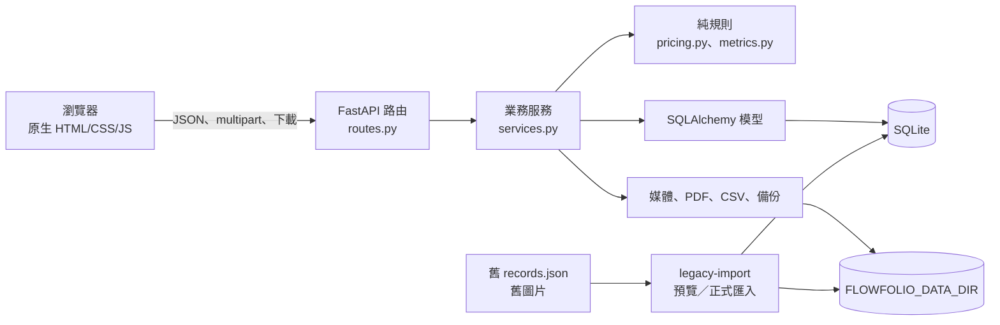
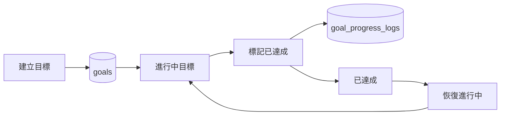

# 架構說明

## 目標

Flowfolio 是單人使用的模組化單體：一個 FastAPI、一個 SQLite、前端編譯成靜態檔案。設計重點是資料可追溯、計算只有一個權威來源、Windows 可操作，而不是提前加入多租戶或分散式元件。

## 資料流

```text
瀏覽器
  ↓ JSON / multipart / 下載
FastAPI 路由（HTTP、狀態碼、錯誤形狀）
  ↓
服務層（交易、流程、跨表一致性）
  ↓
SQLAlchemy 模型與 Alembic schema
  ↓
SQLite + data/media（不在 Git）
```

## 元件關係圖



箭頭方向代表依賴方向：路由不直接操作資料庫或檔案，前端不保存權威業務計算。

報價的後端計價流程是：API schema 驗證 → 服務層轉為 TWD 整數與千分數量 → `domain/pricing.py` 計算 → SQLite 保存 → PDF/CSV 從資料庫重新產生；前端目前不提供報價頁面。

目前前端已移除報價工作台與導覽入口；報價服務、匯出與資料表先保留，讓既有資料和工作紀錄外鍵維持相容。直接開啟舊的 `#/quotes` 路徑會回到總覽。

目標頁面的流程是：建立目標 → 設定名稱、類別與日期 → 標記已達成 → 必要時恢復進行中。數值進度仍由後端保留作為既有 API 與資料相容欄位，前端不要求輸入目前進度、目標值或單位；頁面不依賴計時器，也不限於鋼琴或其他單一活動。



## 目錄與邊界

- `backend/app/api/routes.py`：路由、請求與回應；不直接寫 SQL 或碰檔案。
- `backend/app/services.py`：業務流程、交易與 DTO 轉換。
- `backend/app/domain/`：可獨立測試的計價與統計純函式。
- `backend/app/db/`：SQLAlchemy 模型、SQLite session、Alembic 啟動器。
- `backend/app/infrastructure/`：PDF、CSV、備份、舊資料匯入與圖片處理。
- `frontend/src/`：共用 API client、格式化、路由與功能頁面。
- `scripts/windows/`：Windows 建置、啟動、備份與驗證。

## 刻意不做

不加入 Docker、WSL、PostgreSQL、Redis、Celery、Kafka、WebSocket、React/Vue/Next.js、Supabase、公開註冊、RBAC、付款、推播、外部公開作品集或完整離線雙向同步。若未來有實際瓶頸，先以測量證據決定是否引入新元件。

## 私人存取

正式 FastAPI 只 listen `127.0.0.1`；Tailscale Serve 作為 tailnet 內的 HTTPS 反向代理，Tailscale Funnel 則是使用者明確啟用後的公開 HTTPS 入口。是否只允許本人，取決於使用哪一種入口、tailnet ACL、設備安全與應用程式登入權限；目前 Flowfolio 沒有登入驗證，不能把 Funnel 網址當作權限控制。

