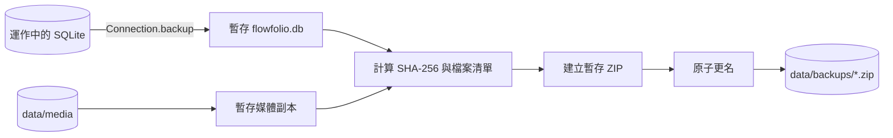

# 備份與還原

## 備份內容

`backend/app/infrastructure/backup.py` 使用 SQLite `Connection.backup()` 建立一致性資料庫快照，再將 `data/media` 與 manifest 放入 ZIP。manifest 包含時間、檔案數、檔案大小與 SHA-256。流程採暫存資料夾 → 產生 manifest → 建立暫存 ZIP → 原子更名，失敗不覆蓋上一份備份。

## 備份流程圖



```powershell
uv run python backend/scripts/backup.py
```

或在網站設定頁按「建立備份」。備份位置預設為 `data/backups`，正式環境建議將資料目錄設在 Git 工作樹之外並另存一份到不同磁碟。

## 還原前

1. 停止 FastAPI 與任何寫入程序。
2. 驗證 ZIP 內 manifest 與檔案 SHA-256。
3. 先對目前資料目錄建立一份原狀備份。
4. 將還原內容放到暫存資料目錄，先執行健康檢查與列表讀取。
5. 使用者確認後才切換 `FLOWFOLIO_DATA_DIR`，不直接覆蓋未備份的正式資料。

## 升級

Alembic schema 升級前先備份，再執行 `uv run alembic upgrade head`。若升級失敗，保留 log 與原狀備份，使用上一份資料目錄回退；不要自行刪除 migration 版本。

