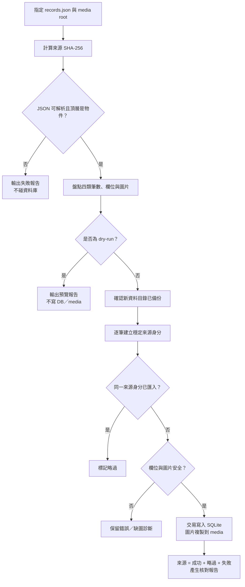

# 舊資料移轉

## 原則

移轉只從使用者指定的外部來源讀取；不修改來源的 JSON、圖片、PDF 或 CSV。每次來源先計算 SHA-256，報告保存來源摘要。資料表保存來源檔案指紋、類別、原始序位與內容摘要，因此同一份來源重跑不會重複插入。

## 匯入流程圖



## 預覽

```powershell
$legacyRoot = Resolve-Path '..\two_project'
$legacySource = Join-Path $legacyRoot 'src\data\records.json'
$legacyMediaRoot = Join-Path $legacyRoot 'src\data\picture'

uv run python backend/scripts/legacy_import.py --dry-run `
  --source $legacySource `
  --media-root $legacyMediaRoot `
  --report reports\legacy-import-dry-run.json
```

預覽不寫 DB、不建立 media 檔案，會列出各類來源筆數、預計匯入、重跑略過、格式錯誤、缺圖與圖片總大小。

## 正式匯入

確認報告後才使用 `--apply`。新的 SQLite 與圖片位於 `FLOWFOLIO_DATA_DIR`；失敗列會保留診斷，舊資料不會刪除。

```powershell
uv run python backend/scripts/legacy_import.py --apply `
  --source $legacySource `
  --media-root $legacyMediaRoot `
  --report reports\legacy-import-apply.json
```

`practice.duration` 依舊畫面契約視為分鐘；舊模型只有 `hours` 時則視為小時。工作 `hours` 轉成分鐘。作品圖片只會在使用者明確提供的 media root 邊界內依檔名尋找，找不到只標記缺圖。

## 回復

移轉前先建立新資料目錄的備份；要撤回新網站資料時停止服務、保留報告與備份，再移除或改用另一個 `FLOWFOLIO_DATA_DIR`。不對外部來源做覆蓋式還原。

