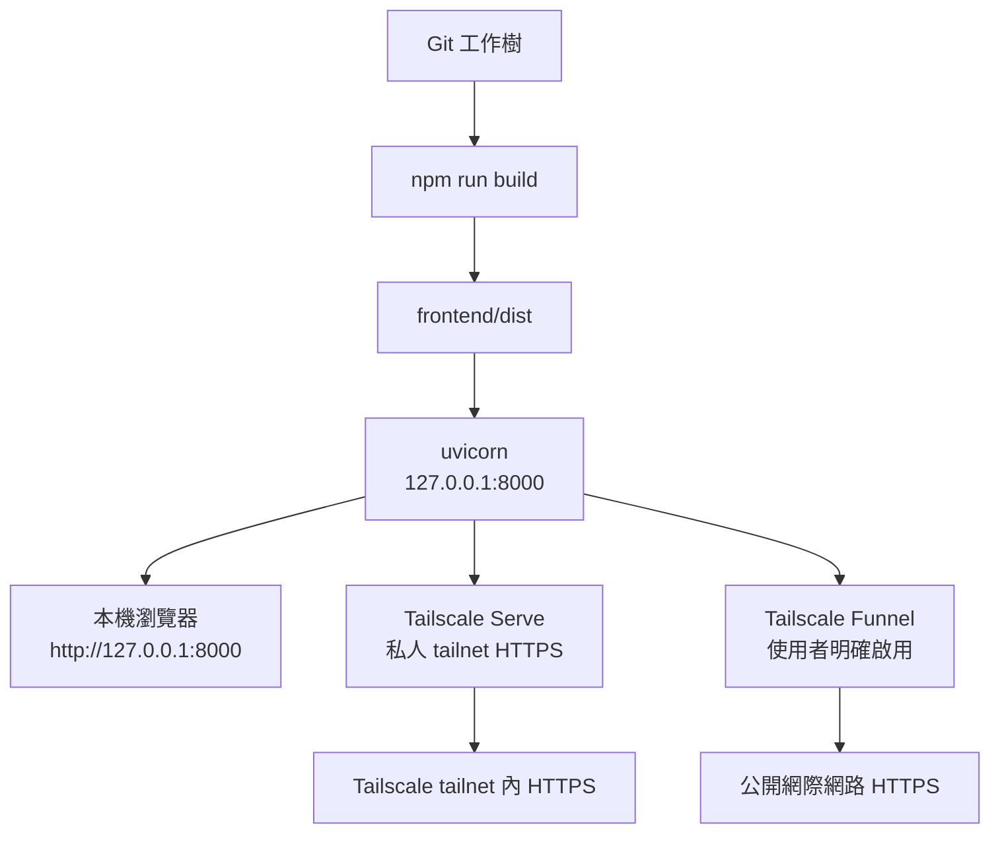

# Windows、Tailscale Serve 與 Funnel

## 開發啟動

```powershell
uv sync
Set-Location frontend
npm install
Set-Location ..
.\scripts\windows\start-dev.ps1
```

## 正式啟動

```powershell
.\scripts\windows\build-web.ps1
.\scripts\windows\start-prod.ps1
```

服務只使用 `127.0.0.1:8000`、單一 worker，不依賴持續執行的 Node 正式伺服器。資料目錄可由 `.env` 的 `FLOWFOLIO_DATA_DIR` 指向非 Git 磁碟位置。

## 啟動與存取流程



Serve 與 Funnel 不是同一種公開程度：Serve 只給 tailnet 內裝置，Funnel 會讓任何取得網址的人從網際網路連線。

## Tailscale Serve

先由使用者在 PowerShell 查證本機版本與現有狀態：

```powershell
tailscale version
tailscale serve --help
tailscale serve status
```

確認 ACL、裝置與希望使用的路徑後，才依本機 CLI 說明將 tailnet HTTPS 代理到 loopback 8000，例如：

```powershell
tailscale serve --bg 8000
tailscale serve status
```

停用時使用本機版本對應的 `tailscale serve reset` 或說明中的等價命令，再確認 `tailscale serve status`。

## Tailscale Funnel（公開外網）

這個流程參考 `hvac-inventory` 的 `外網啟動.bat`，但不複製它的 Discord webhook 或固定個人網域。Flowfolio 會從目前 Tailscale 狀態讀取網址並寫入 `reports/public-funnel.log`。

先啟動正式服務：

```powershell
.\scripts\windows\build-web.ps1
.\scripts\windows\start-prod.ps1
```

再開另一個 PowerShell 或雙擊：

```powershell
.\scripts\windows\啟動Flowfolio公開網站.bat
```

腳本會依序確認 `127.0.0.1:8000/health`、Tailscale 連線，再執行 `tailscale funnel --yes --bg 8000`，最後顯示手機可用的 `https://...ts.net` 網址。手機不需要安裝 Tailscale，使用瀏覽器即可。

第一次啟用 Funnel 時，Tailscale 可能會在終端機顯示 `https://login.tailscale.com/f/funnel?...` 授權網址。請由 tailnet 管理者開啟該網址並核准 Funnel；這是一次性的 tailnet 公開權限設定，核准前不會產生可用的公開網址。

查看狀態：

```powershell
tailscale funnel status
```

停止公開外網：

```powershell
.\scripts\windows\stop-public-funnel.ps1
# 或
tailscale funnel reset
```

Funnel 是公開網際網路入口；Flowfolio 目前沒有登入驗證，請不要把含有私人工作、收入、作品或備份資料的正式資料庫直接暴露給不特定對象。若只需自己手機使用，請改用 Serve。

## 驗證

```powershell
.\scripts\windows\verify-deployment.ps1
```

它會檢查 loopback 健康端點、前端編譯輸出、資料目錄、資料庫版本與備份目錄；Tailscale 狀態若未安裝只會清楚標示未驗證，不會假稱完成。

