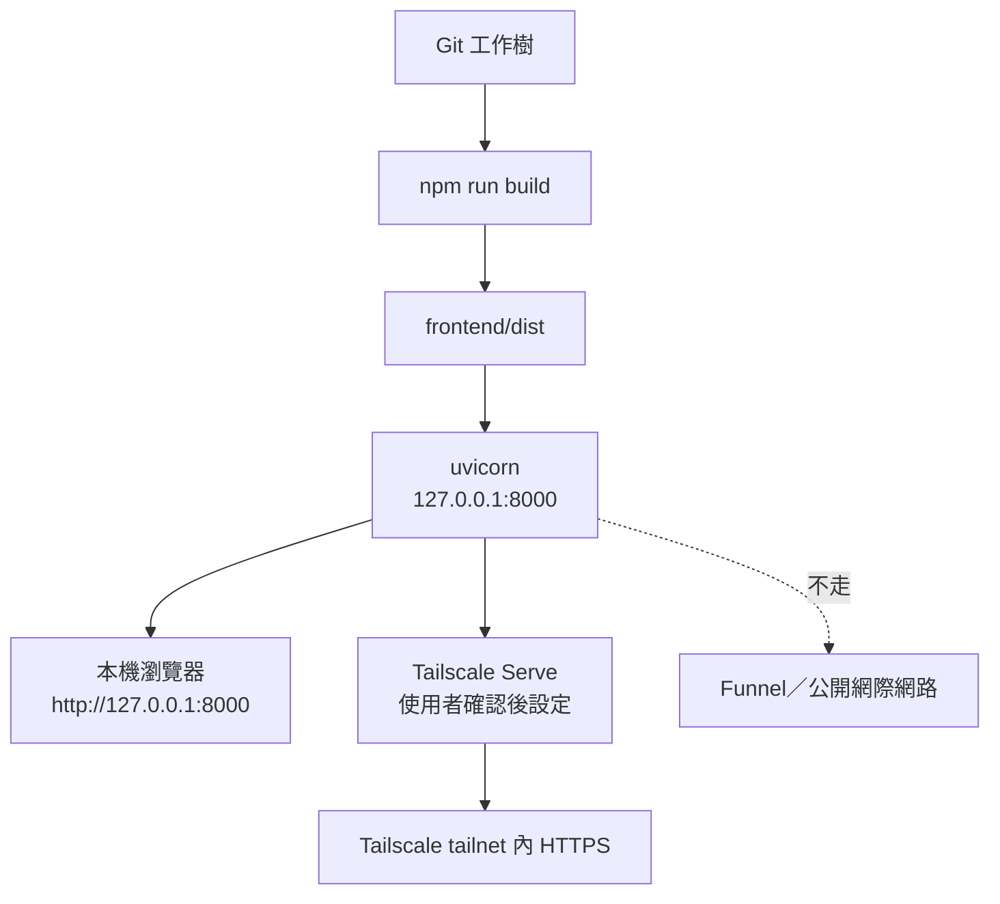

# Windows 與 Tailscale Serve

## 開發啟動

```powershell
uv sync
Set-Location frontend
npm install
Set-Location ..
.\scripts\windows\start-dev.ps1
```

## 正式啟動

```powershell
.\scripts\windows\build-web.ps1
.\scripts\windows\start-prod.ps1
```

服務只使用 `127.0.0.1:8000`、單一 worker，不依賴持續執行的 Node 正式伺服器。資料目錄可由 `.env` 的 `FLOWFOLIO_DATA_DIR` 指向非 Git 磁碟位置。

## 啟動與存取流程



虛線表示明確禁止的方向；Serve 與 Funnel 不是同一種公開程度，不能把 Funnel 當成 Serve 的替代品。

## Tailscale Serve

先由使用者在 PowerShell 查證本機版本與現有狀態：

```powershell
tailscale version
tailscale serve --help
tailscale serve status
```

確認 ACL、裝置與希望使用的路徑後，才依本機 CLI 說明將 tailnet HTTPS 代理到 loopback 8000，例如：

```powershell
tailscale serve --bg 8000
tailscale serve status
```

停用時使用本機版本對應的 `tailscale serve reset` 或說明中的等價命令，再確認 `tailscale serve status`。本專案不自動改動 Tailscale、不開 Funnel、不做路由器 Port Forwarding。

## 驗證

```powershell
.\scripts\windows\verify-deployment.ps1
```

它會檢查 loopback 健康端點、前端編譯輸出、資料目錄、資料庫版本與備份目錄；Tailscale 狀態若未安裝只會清楚標示未驗證，不會假稱完成。

