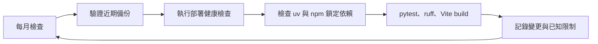
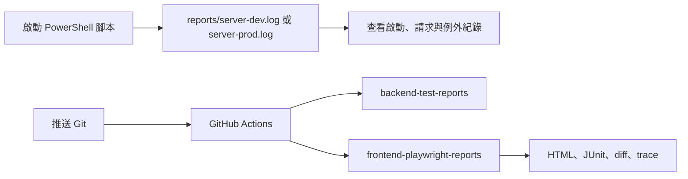

# 長期維護

## 維護節奏圖



## 每次變更

- 新功能同時更新 schema、service、前端、測試與文件。
- 先執行測試與 build，再提交 Git；不要提交 `data`、`backups`、圖片、`.env` 或匯出檔。
- Alembic schema 變更先寫 migration，再備份與升級。

## 每月檢查

- 執行 `uv lock --upgrade` 前先查看版本相容性，更新後跑 pytest、ruff 與 Vite build。
- 檢查 `.env` 的 `FLOWFOLIO_DATA_DIR\backups` 是否有近期成功備份，抽樣驗證一份 ZIP 的 manifest。
- 執行 `verify-deployment.ps1`，查看 loopback 健康與資料庫版本。
- 清理過期暫存檔與 orphan media 前先建立備份，不要直接批次刪除使用者資料。

## Windows 公開網站健康監控

若已使用 Tailscale Funnel 提供手機公開網址，建議安裝每 10 分鐘執行一次的本機健康監控；監控只檢查 `.env` 的 `FLOWFOLIO_FUNNEL_PORT`，不會把同一台電腦上的其他 Funnel 當成 Flowfolio：

```powershell
.\scripts\windows\安裝Flowfolio健康監控.bat
```

監控排程名稱是 `Flowfolio-健康監控`，會依 `.env` 檢查本機 `/health` 與目前 Funnel 的公開 `/health`；預設本機端點是 `127.0.0.1:8000/health`。失敗時會嘗試重新啟動正式服務與 Funnel。完整流程圖、手動驗證和解除方式見 `docs/健康監控維護.md`。

## 故障排查

1. 先看 `/health` 與啟動命令輸出。
2. 確認 `FLOWFOLIO_DATA_DIR`、資料庫檔案與 media 目錄權限。
3. 確認 `uv run alembic current` 與 `uv run alembic upgrade head`。
4. 若是匯入問題，先讀報告的 source SHA-256、錯誤列與缺圖清單。
5. 若是資料問題，停止服務並以最近成功備份建立隔離還原環境，不直接覆蓋現場。

## 服務 Log 與 CI 報告



Windows 啟動腳本會把 uvicorn 的標準輸出、錯誤輸出與 access log 同時顯示在終端機，並追加保存到 `reports/`。`reports/` 已加入 `.gitignore`，私人資料與本機執行紀錄不會提交到 Git。

```powershell
Get-Content .\reports\server-dev.log -Wait
Get-Content .\reports\server-prod.log -Wait
```

GitHub Actions 會保留後端 JUnit 測試報告，以及前端 Playwright HTML／JUnit、失敗截圖、差異圖與 trace 14 天。查看 CI 失敗時，先看工作流程摘要，再下載對應的 artifact；不要只依賴短期的 console log。

