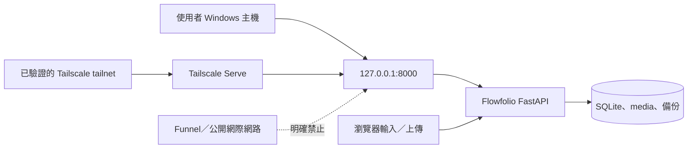

# 安全邊界

## 信任邊界圖

- 正式服務只 bind `127.0.0.1`；私人 HTTPS 由使用者確認後的 Tailscale Serve 提供。
- 不使用 Funnel、公開反向代理、路由器 Port Forwarding，也不將 SQLite、備份、`.env`、原始 JSON、圖片或報價資料提交到 Git。
- API 所有輸入由 Pydantic 驗證；業務錯誤統一為可理解的 JSON，不回傳 traceback。
- 圖片上傳只接受 JPG、PNG、WebP，限制大小與尺寸，使用 UUID storage key，檔案位於 Web root 外；讀取只能依資料庫 media ID，並再次檢查路徑邊界。
- CSV 以 UTF-8 BOM 下載，疑似試算表公式的開頭字元會加上單引號，避免公式注入。
- PDF 不把 Windows 字型檔提交到 Git；可由 `FLOWFOLIO_PDF_FONT` 指定本機合法字型，否則使用 ReportLab 的 CJK CID 字型。
- log 與錯誤回應不寫入完整私人資料、憑證或環境變數。
- 單一使用者產品目前依賴本機邊界與 tailnet ACL，未虛構公開註冊或多使用者權限。若 tailnet 內有其他人，需另外收緊 ACL 或增加經審查的單人登入。

