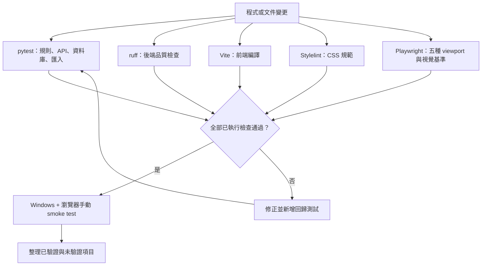

# 測試與驗收

## 測試流程圖



## 可執行命令

```powershell
uv run pytest
uv run ruff check backend
Set-Location frontend
npm run build
npm run lint:css
npm run test:e2e
Set-Location ..
```

後端測試涵蓋純計價、統計單位、API CRUD、唯一報價編號、CSV/PDF 產出、圖片路徑邊界與舊資料 dry-run/idempotency。前端 build 確認 Vite 可產出 FastAPI 需要的 `frontend/dist`；Stylelint 檢查 CSS；Playwright 對主要路由與五組 viewport 檢查水平溢位、鍵盤焦點與視覺基準。

## 手動 smoke test

1. 開啟 `http://127.0.0.1:8000`，確認總覽能載入。
2. 新增工作，檢查收入與工作時數分別出現在 Dashboard。
3. 新增待辦、勾選完成，檢查指定日期與完成率。
4. 建立報價、複製、編輯，下載 PDF 與 CSV，檢查總額一致。
5. 新增作品並上傳 JPG/PNG，重新整理後檢查縮圖與圖片端點。
6. 練習開始、暫停、重新整理、繼續、儲存，確認時間戳快照不歸零。
7. 設定頁下載 JSON、建立備份，確認原 `two_project` 沒有變化。
8. 在 360px、390px、768px、1024px、1440px 寬度檢查側欄／底部導覽與表格可讀性。

## 尚未宣稱的驗證

若執行環境沒有 Playwright 瀏覽器，不能把完整手機／桌面 E2E 標示為通過；需依實際環境安裝後再跑。CSS 專項的盤點、命名、token 與測試矩陣見 `docs/frontend/`。Tailscale、工作排程器與電源策略也必須在使用者 Windows 主機上由使用者確認。

## 本次執行紀錄

以下是本次重構完成時在 Windows 環境實際執行的結果：

| 檢查 | 結果 |
| --- | --- |
| `uv run pytest` | 7 passed |
| `uv run ruff check backend` | 通過 |
| `npm run lint:css` | 通過 |
| `npm run build` | 通過 |
| `npm run test:e2e` | 47 passed；含 41 個版面／焦點測試、3 個 UI 互動測試、1 個導覽命名測試與 2 個視覺基準測試 |
| 真實 FastAPI 服務巡檢 | 8 個路由、390px、無水平溢位 |
| 舊資料匯入重跑 | 第一次匯入 1 筆作品與 2 張圖片；第二次跳過既有資料 |

Playwright 測試使用固定的繁體中文 locale、台北時區與測試 API 資料；真實服務巡檢則連線到 `http://127.0.0.1:8000`，不會把測試資料寫入正式資料庫。

## 實際瀏覽器 UI／UX 驗收

本次最後修改後，使用瀏覽器連線到 `http://127.0.0.1:8000` 進行人工操作，結果如下：

- 總覽：日期與月份欄位、統計卡片、重新整理按鈕與空狀態可見；重新整理後統計仍正常顯示。
- 工作紀錄：中文欄位標籤、收入／工時輸入與工作類型下拉選單可操作；沒有送出測試資料。
- 報價：客戶與報價欄位可見；「新增項目」由 1 列成功增加到 2 列，預覽區仍在同一張卡片內。
- 作品集：已匯入的作品與 2 張圖片可見；點擊縮圖可開啟 dialog，點擊「關閉」後 dialog 數量回到 0。
- 練習：填入曲目後可啟動計時器，狀態顯示「計時中」；點擊暫停後顯示「待機中」與清除計時選項。
- 待辦、分析、設定：主要標題、空狀態／六個月圖表、服務正常訊息與資料操作入口可見。
- 鍵盤：Tab 後焦點落在導覽連結，畫面有明確青綠色 focus ring。
- 響應式：實際瀏覽器確認桌機／平板樣式；360、390、768、1024、1440px 的完整路由矩陣由 Playwright 驗證通過。

驗收期間發現並修正兩個問題：縮小側欄缺少中文 `aria-label`／tooltip，以及 `onClick` 事件名稱大小寫造成按鈕事件未觸發。修正後已重新 build、重啟服務並重做上述操作。

