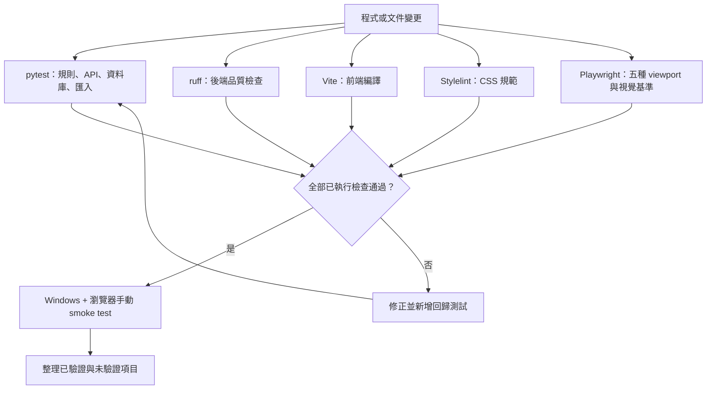

# 測試與驗收

## 測試流程圖



## 可執行命令

```powershell
uv run pytest -n auto
uv run ruff check backend
Set-Location frontend
npm run build
npm run lint:css
npm run test:e2e
Set-Location ..
```

後端測試涵蓋純計價、統計單位、目標進度 API、唯一報價編號、CSV/PDF 產出、圖片路徑邊界與舊資料 dry-run/idempotency。前端 build 確認 Vite 可產出 FastAPI 需要的 `frontend/dist`；Stylelint 檢查 CSS；Playwright 對現有主要路由與五組 viewport 檢查水平溢位、鍵盤焦點、舊報價路由導回、目標區塊與視覺基準。視覺基準固定比較 viewport，避免不同作業系統的整頁高度與捲軸差異造成誤判。

## 手動 smoke test

1. 開啟 `http://127.0.0.1:8000`，確認總覽能載入。
2. 新增工作，檢查收入與工作時數分別出現在 Dashboard。
3. 新增待辦、勾選完成，檢查指定日期與完成率。
4. 新增作品並上傳 JPG/PNG，重新整理後檢查縮圖與圖片端點。
5. 開啟「目標紀錄與回報」頁面，建立不同類型目標，手動更新狀態，完成後檢查移至已達成區塊。
6. 設定頁下載 JSON、建立備份，確認外部移轉來源沒有變化。
7. 在 360px、390px、768px、1024px、1440px 寬度檢查側欄／底部導覽與表格可讀性。

## 尚未宣稱的驗證

若執行環境沒有 Playwright 瀏覽器，不能把完整手機／桌面 E2E 標示為通過；需依實際環境安裝後再跑。CSS 專項的盤點、命名、token 與測試矩陣見 `docs/frontend/`。Tailscale、工作排程器與電源策略也必須在使用者 Windows 主機上由使用者確認。

## 本次執行紀錄

以下是本次重構完成時在 Windows 環境實際執行的結果：

| 檢查 | 結果 |
| --- | --- |
| `uv run pytest -n auto` | 8 passed；使用 pytest-xdist 平行 worker |
| `scripts/windows/run-tests.ps1 -Serial` | 8 passed；單程序除錯模式 |
| `uv run ruff check backend` | 通過 |
| `npm run lint:css` | 通過 |
| `npm run build` | 通過 |
| `npm run test:e2e` | 43 passed；含 35 個路由版面測試、2 個導覽／焦點測試、4 個 UI 互動測試與 2 個視覺基準測試 |
| 真實 FastAPI 服務巡檢 | 7 個路由、390px、無水平溢位 |
| 舊資料匯入重跑 | 第一次匯入 1 筆作品與 2 張圖片；第二次跳過既有資料 |

Playwright 測試使用固定的繁體中文 locale、台北時區與測試 API 資料；真實服務巡檢則連線到 `http://127.0.0.1:8000`，不會把測試資料寫入正式資料庫。

## 平行測試策略

後端使用 `pytest-xdist` 批量分配測試：

```powershell
uv run pytest -n auto
```

`-n auto` 會依目前 CPU 數量建立 worker，適合 CI 與完整回歸測試；測試很少或需要逐步除錯時，使用 `uv run pytest -n 0` 回到單程序。每個測試的資料庫都建立在 pytest 的獨立暫存目錄，不共用正式 `data/flowfolio.db`，因此可以安全平行執行。Playwright 本身已啟用 `fullyParallel`，前端版面與互動案例也會由 Playwright worker 分批執行。

目前後端有 8 個測試，worker 啟動成本可能高於平行收益；這次仍先把平行策略接入 CI 與標準命令，待測試數量增加後收益會更明顯。需要快速定位單一失敗時，使用 `uv run pytest -n 0` 或 `scripts/windows/run-tests.ps1 -Serial`。

## CI 報告保存

GitHub Actions 會保存以下 artifact 14 天：

- `backend-test-reports`：pytest JUnit XML，方便查看每個後端案例的狀態。
- `frontend-playwright-reports`：Playwright HTML／JUnit 報告，以及失敗時的 actual、diff、error context 與 trace。

前端視覺測試允許小幅的跨 runner 像素差異，但仍保留版面／水平溢位測試；若差異超過門檻，應下載 artifact 查看 diff，不要直接更新基準圖。

## 實際瀏覽器 UI／UX 驗收

本次最後修改後，使用瀏覽器連線到 `http://127.0.0.1:8000` 進行人工操作，結果如下：

- 總覽：日期與月份欄位、統計卡片、重新整理按鈕與空狀態可見；指定日期若有到期目標，會顯示進度與「更新進度」入口。
- 工作紀錄：中文欄位標籤、收入／工時輸入與工作類型下拉選單可操作；沒有送出測試資料。
- 舊報價路由：直接開啟 `#/quotes` 會導回總覽，桌面與手機導覽都不再顯示報價入口；後端報價 API 與資料表保留相容性。
- 日常紀錄／作品集：頁首以小字顯示「日常紀錄」、大字顯示「作品集」；作品表單與作品卡片只顯示日期，不提供時間欄位；已匯入的作品與 2 張圖片可見，點擊縮圖可開啟 dialog，點擊「關閉」後 dialog 數量回到 0。
- 目標：建立表單不顯示目前進度、目標值與單位；可看到進行中與已達成兩個區塊，目標卡可標記完成或恢復進行中；頁面不再出現計時器。
- 字體與字重：全站中文文字、導覽、表單、按鈕與原生輸入控制項統一使用標楷體字體堆疊，並以粗體呈現。
- 配色：全站背景、側欄、卡片、表單、按鈕與行動導覽統一採用偏白的藍白漸層與亮藍視覺系統。
- 淺白半透明介面：卡片、表單欄位、清單列、作品卡、目標卡、提示框與行動導覽使用偏白透明框面，仍可透出底層漸層，文字與邊框保持清楚。
- 品牌圖片：只有總覽頁內容區顯示 `Flowfolio 右上角品牌字樣`；左側品牌導覽在所有頁面只保留「Flowfolio」與「工作與目標節奏」文字，其他頁面不顯示 Logo 圖片。
- 待辦、分析、設定：主要標題、空狀態／六個月圖表、服務正常訊息與資料操作入口可見。
- 鍵盤：Tab 後焦點落在導覽連結，畫面有明確亮藍色 focus ring。
- 響應式：實際瀏覽器確認桌機／平板樣式；360、390、768、1024、1440px 的完整路由矩陣由 Playwright 驗證通過。

驗收期間發現並修正兩個問題：縮小側欄缺少中文 `aria-label`／tooltip，以及 `onClick` 事件名稱大小寫造成按鈕事件未觸發。修正後已重新 build、重啟服務並重做上述操作。

