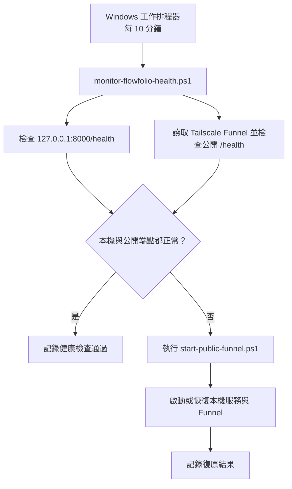

# Flowfolio 健康監控維護

## 目的

Flowfolio 參考 `hvac-inventory` 的 Windows 維護方式，使用工作排程器每 10 分鐘執行一次健康檢查。監控會同時確認：

- 本機正式服務 `http://127.0.0.1:8000/health`。
- Tailscale Funnel 目前公開的 HTTPS `/health`。

任一端點失敗時，監控會重新執行公開網站啟動流程，讓本機服務與 Funnel 有機會自動恢復。監控只記錄本機檔案，不會自行傳送資料或通知第三方服務。

## 監控流程



## 安裝與解除

在 Flowfolio 專案根目錄執行，或直接雙擊對應的批次檔：

```powershell
.\scripts\windows\安裝Flowfolio健康監控.bat
```

安裝後會建立工作排程 `Flowfolio-健康監控`，使用目前 Windows 使用者執行，不需要把密碼寫入專案。工作會在安裝後先執行一次，之後每 10 分鐘執行一次。

若要移除排程：

```powershell
.\scripts\windows\解除Flowfolio健康監控.bat
```

檢查排程狀態：

```powershell
Get-ScheduledTask -TaskName 'Flowfolio-健康監控' | Get-ScheduledTaskInfo
```

## 手動驗證

不建立排程，只執行一次檢查：

```powershell
powershell.exe -NoProfile -ExecutionPolicy Bypass `
  -File .\scripts\windows\monitor-flowfolio-health.ps1 -Once
```

成功時應看到本機健康與公開 Funnel 都是 `True`。若 Tailscale 尚未連線、Funnel 尚未核准或公開網址暫時不可用，監控會記錄失敗並嘗試復原；它不會繞過 Tailscale 登入或 Funnel 權限。

## Log 位置

- `reports/health-monitor.log`：每次檢查與復原結果。
- `reports/server-prod.log`：正式服務啟動輸出。
- `reports/public-funnel.log`：Funnel 啟動、網址與狀態。

即時查看健康監控：

```powershell
Get-Content .\reports\health-monitor.log -Wait
```

## 維護注意事項

- Windows 工作排程器必須允許目前使用者登入時執行；若電腦完全關機，排程會在下次可執行時補跑，不代表關機期間仍能提供網站。
- Tailscale 必須保持 Connected，且 Funnel 必須已完成管理者核准。
- Flowfolio 目前沒有登入驗證；公開 Funnel 的網址可被取得網址的人開啟，請只放可公開的資料。
- 此監控不提交 `reports/`、SQLite、備份或媒體檔案到 Git。
